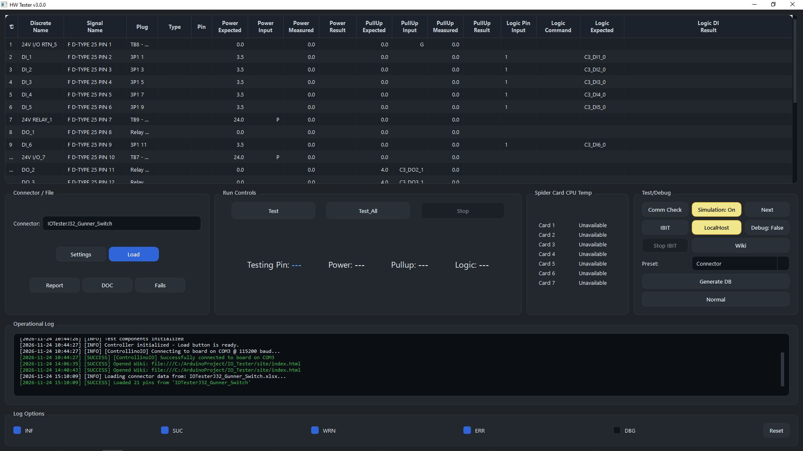
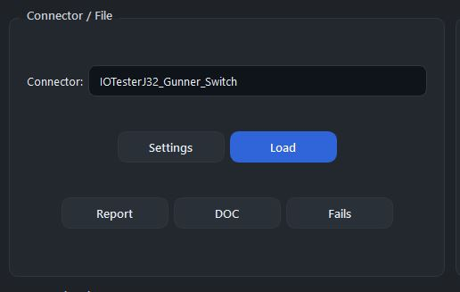
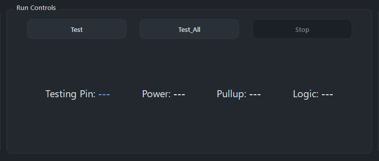
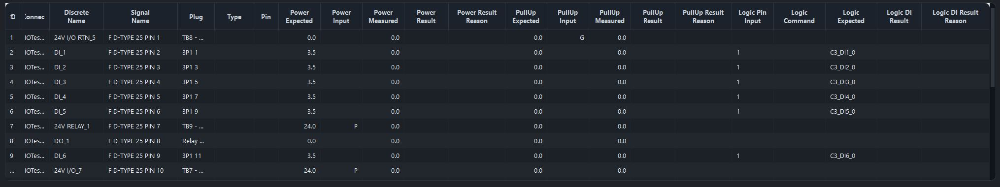
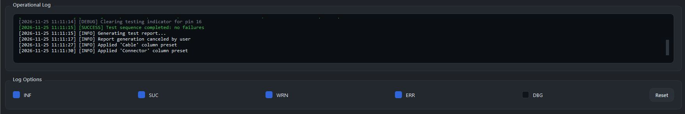
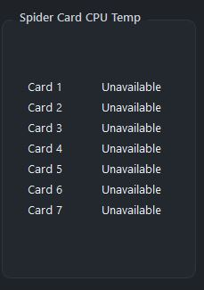
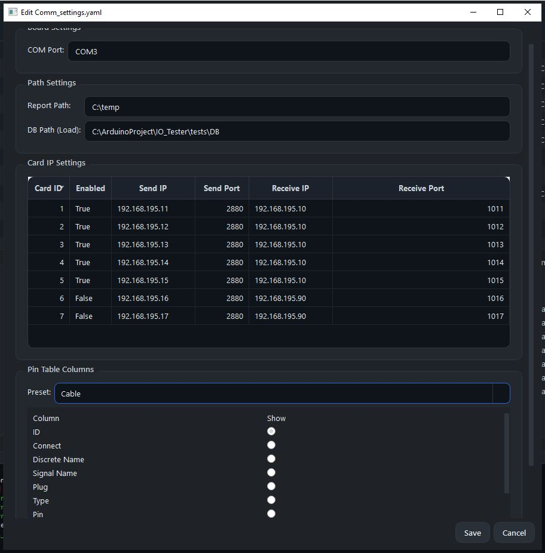
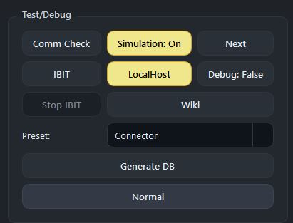

# Engineering View - User Manual

## 1. Purpose

Engineering View provides access to the full pin table, individual-pin test controls, configuration, diagnostic tools, and report generation. Use this view to inspect or edit test data, run tests on selected pins, and troubleshoot hardware or configuration issues.

The application supports **Power**, **Pull-Up**, **Logic**, and **Cable** tests. The loaded connector file determines which tests apply to each pin. For detailed test procedures and input requirements, see the dedicated [Power Test](power-test.md), [Pull-Up Test](pullup-test.md), [Logic Test](logic-test.md), [Cable Test](cable-test.md), and [I-BIT Test](ibit-test.md) guides.

## 2. Before you begin

- Power on the IO Tester and connect it to the PC/laptop via USB. Confirm its red and green indicators are on and the MUX card's green LED is lit.
- Connect the IO Tester's ground wire to the IO Box ground so they share a common ground.
- Power on the IO Box and connect it to the test network.
- Connect the PC/laptop to the IO Box network via LAN.
- Confirm the configured COM port is correct.
- Confirm that **Simulation** and **LocalHost / IO Box** are set to the intended modes before starting a test.

The application can also run in simulation or localhost mode for development and demonstrations. These modes do not replace a hardware verification run.

## 3. Engineering View layout

The window is organized into three main areas:

1. **Pin table** - connector data, editable test inputs, and test results.
2. **Control groups** - Connector / File, Run Controls, Spider Card CPU Temp, and Test/Debug.
3. **Operational Log and Log Options** - live messages and filters.

The controls are described below in the order they appear in the window.

## 4. Connector / File

| Control | What it does |
|---|---|
| **Connector** | Shows the name of the loaded connector file. The report filename is based on this field. |
| **Settings** | Opens the application settings dialog. See [Settings](#9-settings). |
| **Load** | Opens a file picker to load a connector test workbook (`.xlsx` or `.xls`). The workbook's pin data is displayed in the table. |
| **Report** | Creates an Excel report from the current pin table. You can edit the suggested filename before saving. |
| **DOC** | Opens the report-selection dialog for creating a Word document report. |
| **Fails** | Opens the report-selection dialog for creating a combined Excel report containing failed results. |

Reports are saved to the configured report folder. A report is also offered for saving automatically when a test run finishes. Automatically generated reports include a **Pass**, **Fail**, or **Not Complete** outcome in the filename and the workbook's Comments property.

## 5. Run Controls

| Control | What it does |
|---|---|
| **Test** | Runs the test sequence for the selected table rows. Select one or more rows in the pin table first. |
| **Test_All** | Selects and tests every row in the table. |
| **Stop** | Requests that the current test sequence stop. The test handler stops at a safe point in its sequence. |

The Test and Test_All controls are unavailable until a connector file has been loaded. During a run, the selected pin rows are cleared and the active pin is highlighted. The **Stop** control becomes available while testing.

The status values below the buttons show:

- **Testing Pin** - the pin currently being tested.
- **Power** - the latest Power test status.
- **Pullup** - the latest Pull-Up test status.
- **Logic** - the latest Logic test status.

These indicators return to `---` when a new run starts and are cleared when the run finishes. Use the pin table and Operational Log for the complete results and explanations.

## 6. Pin table

The table contains 22 columns
the input data come from the Test DB excel file, all the data ( test values-"input"  + result-"output") is store in the test Excel result file  . 
Some of the data can be edit in this mode, for saveig the data update the excel DB file 
Use the horizontal scrollbar or a column preset to see the fields you need.

| Column | Description | Approved values / format |
|---|---|---|
| `ID` | Unique pin/row identifier from the connector data. |value = integer, source = input, excel column H "Pin Out", read only. |
| `Connect` | Connector identifier or name. | Value = String, Source = input, the excel file name, read only. |
| `Discrete_Name` | Functional name of the discrete signal. | value = string, source = input, excel column B "DISCRETE NAME", read only. |
| `Signal_Name` | Signal name from the source data. |value = string, source = input, excel column C "SIGNAL NAME", read only.  |
| `Plug` | Plug or connector designation. | value = string, source = input, excel column J "PLUG", read only. |
| `Type` | Pin or test type from the source data. | value = string, source = input, excel column D "TYPE".Use `Cable` to select the Cable test , read only. |
| `Pin` | Physical pin number on the SPider Card connector  or Dimer cards. |value = string, source = input, excel column K "Pin", read only.  |
| `Power_Expected` | Expected voltage for the Power test. | value = integer, source = input, excel column N "Power_Expected", editable. |
| `Power_Input` | Command or input type used for the Power test. | value = string, Blank , `none`, `P`\ `p`, or `Power` for direct measurement; for operate an analog output as part of the test use `C{card}_AO{channel}_{value}` for exsaple C1_AO5_10 = card 1 + Analog outpt 5 + inject 10 (Card and channel must exist in the configuration), source = input, excel column O "Power_Input" ,editable. |
| `Power_Measured` | Measured Power-test voltage. | value = integer, source = Output, excel column J "Power_Measured", read only. |
| `Power_Result` | Power-test result. | value = string, set by the test: `Pass`, `Fail`, or blank when not run , source = Output, excel column K "Power_Result", read only. |
| `Power_Result_Reason` | Explanation of the Power-test result. | value = string, set by the test explanatory text, source = Output, excel column L "Power_Result_Reason", read only. |
| `PullUp_Expected` | Expected voltage for the Pull-Up test. |  value = integer, source = input, excel column P "PullUp_Expected", editable. |
| `PullUp_Input` | Pull-up command or input type. | value = string ,`G` for a ground test;  for operate an digital putput as part of the test use `C{card}_DO{channel}_{0 or 1}` for example C2_DO13_1 = card 2 + Digital output 13 + inject "on" , source = input , excel column Q "PullUp_Input" ,editable. |
| `PullUp_Measured` | Measured Pull-Up voltage. | value = integer, source = Output, excel column O "PullUp_Measured", read only. |
| `PullUp_Result` | Pull-Up test result. |  value = string, set by the test: `Pass`, `Fail`, or blank when not run , source = Output, excel column P "PullUp_Result", read only. |
| `PullUp_Result_Reason` | Explanation of the Pull-Up result. | value = string, set by the test explanatory text, source = Output, excel column Q "PullUp_Result_Reason", read only. |
| `Logic_Pin_Input` | Related pin to connect or input used for the Logic or Cable test. | Value = integer for related pin number(s) or char in case of source connector for Cable test such as `C`, `E`, or `H`, source = input, excel column R "logic_input" ,editable. |
| `Logic_Command` | Command sent for the Logic test - use in matrix test. | value = string Blank, for operate an digital putput as part of the test use `C{card}_DO{channel}_{0 or 1}` for example C3_DO2_1 = card 3 + Digital output 2 + inject "on", source = input, excel column S "Logic_Command" ,editable. |
| `Logic_Expected` | Expected Logic-test value or Cable-test connection information. | value = string , data to be read\check  from  Spider card can be : `C{card}_DI{input}_{0 or 1}`, `C{card}_AI{input}_{value}`, or `C{card}_IE{input}_{value}`. Cable: connector pins such as `K(1),L(1)` or `G(11,13,14,15)`, source = input, excel column T "Logic_Expected" ,editable. |
| `Logic_DI_Result` | Logic or Cable test result. |  value = string, set by the test: `Pass`, `Fail`, or blank when not run , source = Output, excel column U "Logic_DI_Result", read only. |
| `Logic_DI_Result_Reason` | Explanation of the Logic or Cable result. | value = string, set by the test explanatory text, source = Output, excel column V "Logic_DI_Result_Reason", read only. |

For command formats, replace `{card}`, `{channel}`, `{input}`, and `{value}` with the configured card number, channel/input number, and expected value. Event-string values are non-negative integers; for digital inputs, `0` and `1` represent LOW and HIGH. Metadata columns such as `Discrete_Name`, `Signal_Name`, and `Plug` do not have application-wide approved-value lists; use the values defined by the connector workbook and project configuration.

### Selecting and sorting rows

- Click a row to select it.
- Hold **Ctrl** while clicking to select or deselect additional rows.
- Hold **Shift** while clicking to select a range.
- Click a column header to sort by that column. Click again to reverse the sort order.
- Hover over a cell to see its full value as a tooltip.

The **Test** button runs the selected rows. **Test_All** selects all rows before starting the run.

### Editing test inputs

Double-click a supported input cell to edit it:

- `Power_Expected` and `Power_Input`
- `PullUp_Expected` and `PullUp_Input`
- `Logic_Pin_Input`, `Logic_Command`, and `Logic_Expected`

Expected-voltage cells must contain numeric values. Other input cells accept text. Review edits before running a test; changes are used by subsequent test runs.

### Table colors and column visibility

- The pin currently being tested is highlighted.
- Result values are color-coded: **Pass** is green and **Fail** is red.
- Untested rows use alternating background shades.
- Hidden columns are not removed from the loaded data; change the visible columns with the **Preset** control or the Settings dialog.

## 7. Log

The **Operational Log** displays messages from application startup, hardware checks, test runs, and report generation.
The **Log Options** controls are below the log.

| Filter | Shows |
|---|---|
| **INF** | General information. On by default. |
| **SUC** | Successful operations and test events. On by default. |
| **WRN** | Warnings, including failed tests and skipped operations. On by default. |
| **ERR** | Errors such as hardware or file problems. On by default. |
| **DBG** | Detailed diagnostic messages. Off by default. |

Use the checkboxes to filter the displayed messages. If every filter is unchecked, all message levels are shown.

Click **Reset** to clear the log. This does not clear test results from the pin table.

## 8. Spider Card CPU Temp

The **Spider Card CPU Temp** panel shows the CPU temperature of each enabled IO card, refreshed every second from the card's web status endpoint. Seven cards are visible at once; use the vertical scrollbar if more are configured. Unreachable cards or invalid responses show **Unavailable**; hover over the value for details. Temperatures are unavailable in localhost mode.

The `Card_temperature` values in `settings.yaml` define the upper limits of the green, yellow, and orange zones. With the configured values of 40, 50, and 60 °C, the display is green at or below 40 °C, yellow above 40 to 50 °C, orange above 50 to 60 °C, and red above 60 °C. An error is logged when a card enters a non-green zone or changes between non-green zones, not on every refresh. The three limits must be finite numbers in increasing order; invalid or missing limits are reported in the log and tooltip and no color is assigned.

## 9. Settings

Click **Settings** to open the settings dialog. Review changes carefully; communication and card-network settings can interrupt hardware communication.

### Board Settings

| Setting | Purpose |
|---|---|
| **COM Port** | Serial port used to communicate with the Controllino. Choose the port assigned by Windows. |

### Path Settings

| Setting | Purpose |
|---|---|
| **Report Path** | Folder where Excel and Word reports are saved. |
| **DB Path (Load)** | Root folder containing connector projects and their test workbooks. |

### Card IP Settings

The card table contains the following fields:

| Field | Purpose |
|---|---|
| **Card ID** | Identifier for the IO card. |
| **Enabled** | Whether the application uses the card. |
| **Send IP / Send Port** | Destination address and port for commands sent to the card. |
| **Receive IP / Receive Port** | Local address and port used to receive card responses. |

Edit a cell by double-clicking it. Use the **Enabled** selector to enable or disable a card. Card IDs are not editable in this table.

### Pin Table Columns

The Settings dialog lets you choose a preset and show or hide individual columns. Click **Save** to save settings or **Cancel** to discard changes. The main-window **Preset** selector applies a saved column preset immediately.

After saving changes to the COM port or card communication settings, restart the application when prompted so the communication changes can take effect.

## 9. Test/Debug controls

| Control | What it does |
|---|---|
| **Comm Check** | Pulses the configured Controllino digital ports and pings enabled IO cards. The control indicates whether the overall check passed; details appear in the Operational Log. |
| **IBIT** | Starts the built-in test. Before the circuit test, the application asks you to ensure IO Box hardware and cables are disconnected. The test may also prompt you to connect fuse-test cable. |
| **Stop IBIT** | Stops a running IBIT. In Normal View, the IBIT button changes to **Stop IBIT** while the test is active. |
| **Simulation: On/Off** | Switches between simulated operation and hardware operation. The selected mode is saved in settings. When switching from simulation to hardware, the application checks the configured COM port and logs a warning if it is unavailable. |
| **LocalHost / IO Box** | Selects localhost simulation for IO-card communication or communication with the IO Box. The UDP card manager restarts when the mode changes. Switching to IO Box requires restarting the application. |
| **Next** | Continues a test that is paused at a debug checkpoint. It has no effect when execution is not waiting for a checkpoint. |
| **Debug: True/False** | Enables or disables step-by-step debug mode. In debug mode, a test can pause at checkpoints until **Next** is clicked. |
| **Wiki** | Opens the local HTML documentation site, if it has been built and is available. |
| **Preset** | Changes the visible pin-table columns using the selected saved preset. |
| **Generate DB** | Opens the DB Creator utility, which builds connector test workbooks from a source workbook. |
| **Normal** | Switches to the simplified Normal View. |

### Comm Check

Comm Check runs without loading a connector test workbook. Follow these instructions:

1. Check that the PC/laptop communicates correctly with the IO Tester and the IO Box (Spider Card).
2. When you run the test, the Controllino DI LED flashes to indicate that the Controllino is responding. The tester then pings the configured IO cards.
3. The check takes about one minute.
4. The Comm Check button turns **green** if all checks pass or **red** if any failures are detected.

### Running IBIT

IBIT runs without loading a connector test workbook. Follow the prompts shown by the application:

1. check  the IO Tester operate properly , all the 50 pin are reachable for system A and B + Fuses or good 
2. Ensure the IO Box hardware and cables are disconnected before continuing with the circuit test.
3. The Controllino DI LED and the MUX card indicate activity while the 50-pin connector's logic and fuses are tested.
4. The IBIT button turns **green** if all checks pass or **red** if any failures are detected.
5. The test takes about 10 minutes. You can stop it before it finishes by clicking the button again.
6. When prompted for the fuse test, connect the fuse-test cable and choose **Continue**.
7. Choose **Ignore** to skip the prompted circuit or fuse test.
8. Click **Stop IBIT** to request that a running test stop.

The IBIT button indicates the overall result, and the Operational Log contains detailed messages. For the full procedure and interpretation, see the [I-BIT Test Guide](ibit-test.md).

## 10. Typical workflows

### Load and test a connector

1. Click **Comm Check** and **Ibit** and review the result and log + make sure the IO Tester ground wire connet to the IO BOx.
2. Click **Load**, choose the connector workbook, and verify that the expected rows appear in the table.
3. Review the pin data and any editable test inputs.
4. Select rows and click **Test**, or click **Test_All** to test every row.
5. To stop early, click **Stop**.
6. When the run finishes, choose whether to save the generated Excel report.

### Review or create reports

- Use **Report** to save the current pin table to Excel.
- Use **DOC** to create a Word report from selected report files.
- Use **Fails** to create a combined Excel report containing failed results.
- See the Normal View manual for its report list and double-click-to-open behavior.

### Build connector test workbooks

Click **Generate DB** to open the DB Creator utility. In that utility, select a source workbook and output folder, review the source tabs and column mapping, then generate the connector files. The source workbook is not modified. See the [DB Creator guide](connector-targets.md) for details.

## 11. Test results

The table displays **Pass** or **Fail** for tests that ran. A blank result indicates that no result is currently recorded for that test; some tests may be skipped when their required inputs or prerequisites are not present. Check the corresponding reason column and Operational Log for more information.

The results banner and counters in Normal View summarize a complete run. The Engineering View status indicators show the latest test status while a run is in progress. For test-specific conditions and expected values, use the dedicated guides:

- [Power Test](power-test.md)
- [Pull-Up Test](pullup-test.md)
- [Logic Test](logic-test.md)
- [Cable Test](cable-test.md)
- [I-BIT Test](ibit-test.md)

## 12. Troubleshooting

| Symptom | What to check |
|---|---|
| The application reports a hardware or COM-port problem. | Confirm the Controllino is connected and that **Settings > COM Port** matches the port assigned by Windows. |
| **Comm Check** fails. | Check the Controllino connection, enabled card settings, card IP addresses, and IO Box network connection. Review the Operational Log for the specific failure. |
| A UDP binding error appears. | Another application may be using the configured receive port. Close other IO Tester instances and check the card receive ports. |
| **Test** or **Test_All** is unavailable. | Load a connector workbook first. |
| Expected columns are missing from the table. | Choose **All** or another suitable **Preset**, or enable the columns in Settings. |
| Tests fail unexpectedly. | Verify the selected connector file, UUT wiring, test inputs, and simulation/connection modes. Check the result-reason columns and log. |
| **Wiki** cannot open the documentation. | Build the documentation site and confirm it is available in the location expected by the application. |

---

For operator instructions, see the [Normal View User Manual](Normal-View-user-manual.md).
