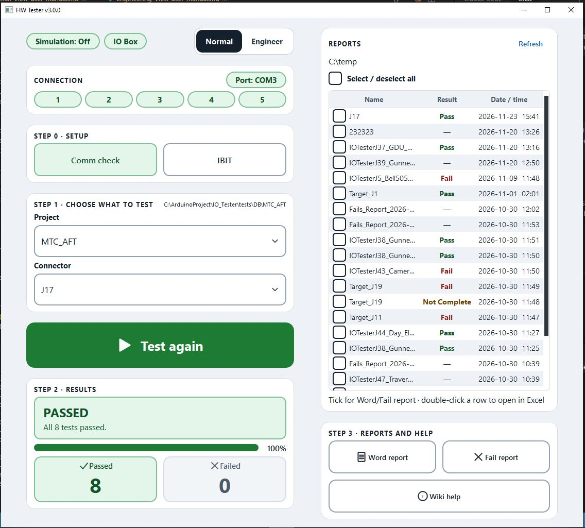
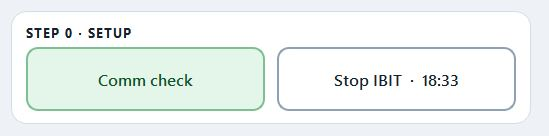
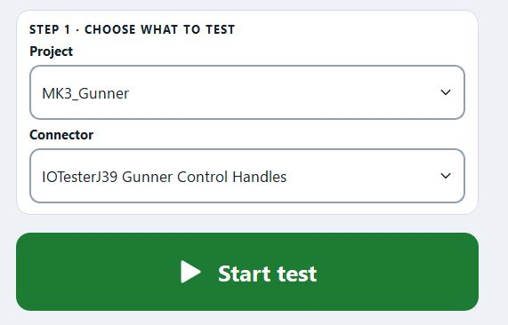
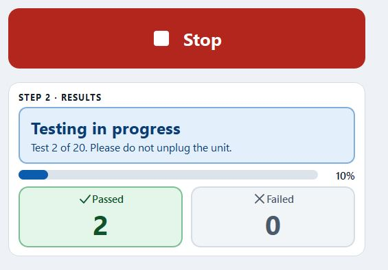
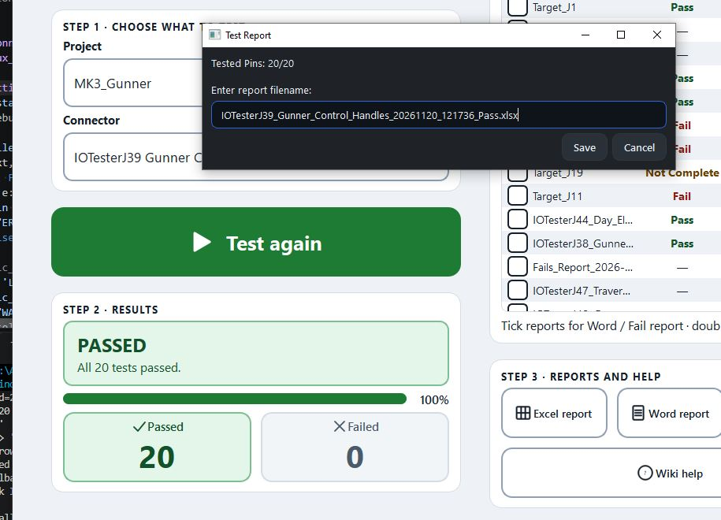
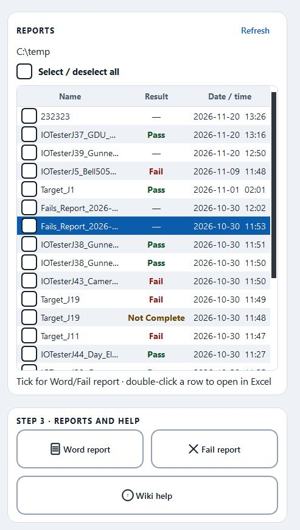

# Normal View - User Manual

## Before you begin

- [ ] The IO Tester is powered on and connected to the PC/laptop via USB. Its red and green indicators are on, and the MUX card's green LED is lit.
- [ ] The IO Tester's ground wire is connected to the IO Box ground (they share the same ground).
- [ ] The IO Box is powered on and connected to the test network.
- [ ] The PC/laptop is connected to the IO Box network via LAN.

---

## Step A - Launch the application

Double-click `IO_Tester.exe`.

The application opens in Normal View, which includes:

- Status indicators for simulation mode, connection target, and the selected view
- A Connection panel showing the COM-port check and enabled Spider-card temperatures
- Step 0: Setup
- Step 1: Choose what to test
- The Start Test button
- Step 2: Results
- The list of available reports
- Step 3: Reports and help

At startup, the application attempts to connect to the IO Tester using the predefined settings configured in Engineering View. These settings can be changed there.

The **Connection** panel's Port indicator shows the configured COM port and the result of its last board connection check: green for success, red for failure, and yellow if it has not been checked or the port was changed and requires a restart. It is not a continuous disconnection monitor.

Each enabled Spider card has an indicator labeled with its card ID. Up to seven indicators appear in one row. Hover over an indicator for the card ID, address, temperature, or unavailable reason. It uses the same temperature zones and one-second updates as Engineering View: green, yellow, orange, then red as the configured limits are crossed. Yellow also indicates a temperature that is unavailable or still being read. These indicators show CPU temperature, not the result of Comm Check.

---

## Step B - Check communication and system operation

Run the setup checks once before testing the IO Box, or again whenever needed.

Click **Comm Check**.

- The Controllino DI LED flashes to indicate that the Controllino is responding. The tester then pings the configured IO cards.
- The check takes about one minute.
- The Comm Check button turns **green** if all checks pass or **red** if any failures are detected.

Click **IBIT** to run the built-in test.

- The Controllino DI LED and the MUX card indicate activity while the 50-pin connector's logic and fuses are tested.
- The IBIT button turns **green** if all checks pass or **red** if any failures are detected.
- The test takes about 20 minutes. You can stop it before it finishes by clicking the button again.
- Logic or fuse checks can be bypassed if they are not needed.
- Check the log for procedure status and details about cable or COM port issues.

---

## Step C - Select a test file

Connect the tester to the appropriate connector on the IO Box.

1. Select a project from the **Project** list.
2. Select a connector from the **Connector** list.

The selected project's folder path appears beside **Step 1 · Choose what to test**. Hover over the path to see it in full. The project folder is configured in the Engineering View settings.

Once a connector is selected, the **Start test** button becomes available.

---

## Step D - Run the tests

Click **Start test**.

- The tester runs the connector test and shows progress, including the number of passed and failed tests.
- Click **Stop** to stop the test run before it finishes.
- When the run ends, a dialog lets you choose whether to save the report.

---

## Step E - View and create reports

Saved Excel reports appear in the Reports list. The Result column shows **Pass**, **Fail**, or **Not Complete**. Double-click a report row to open the file in Excel.

Select one or more reports using the checkboxes, then choose **Word report** to create a document report (ATR) or **Fail report** to create a combined Excel report of failures.

---

For full reference, see the [User Manual (Engineering View)](Engineering-View-user-manual.md).
