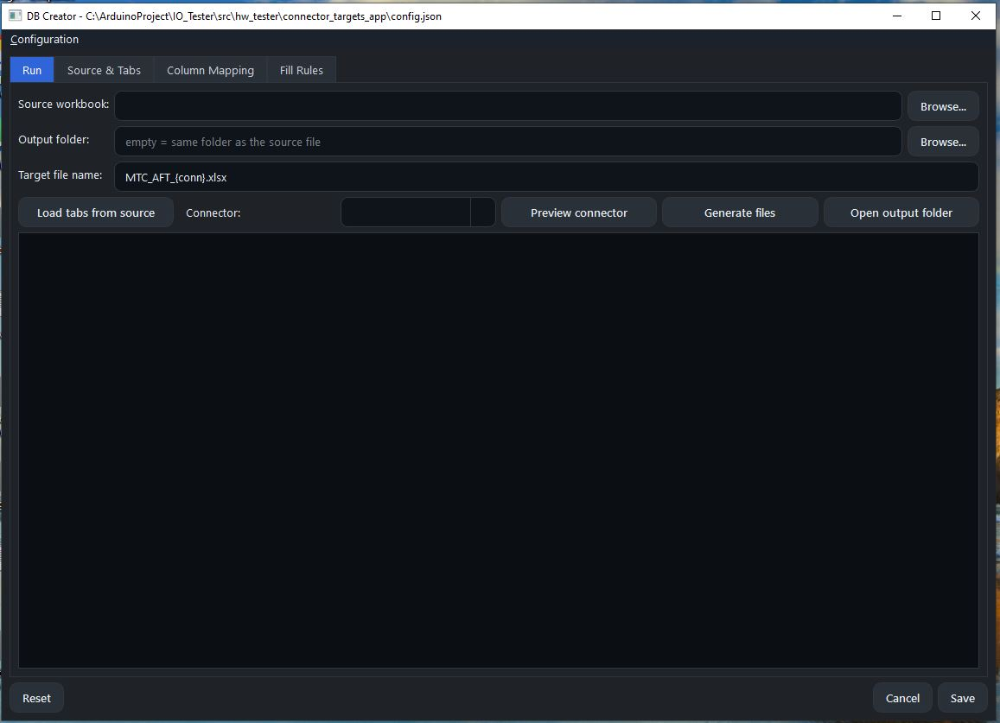
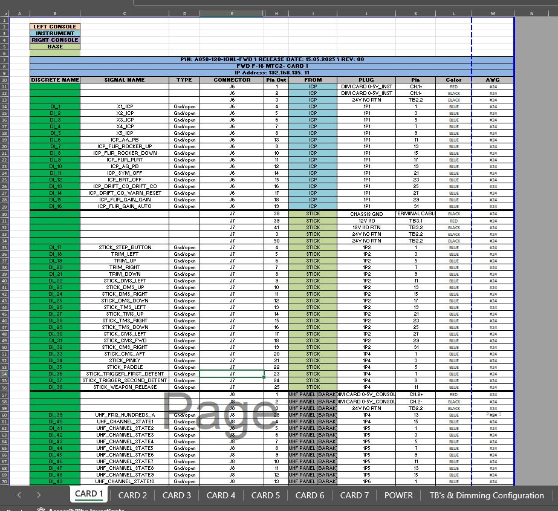
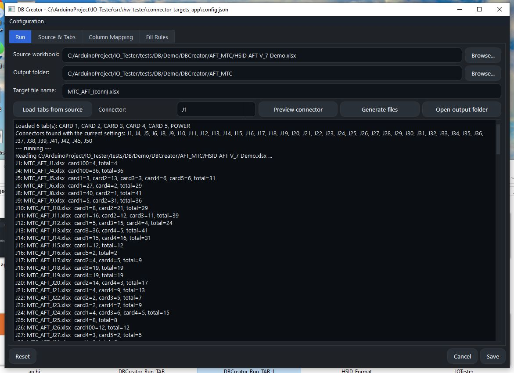
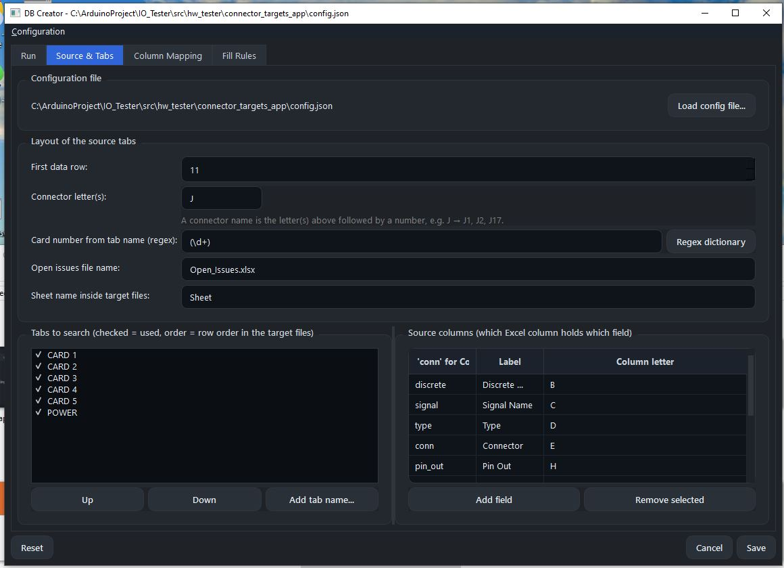
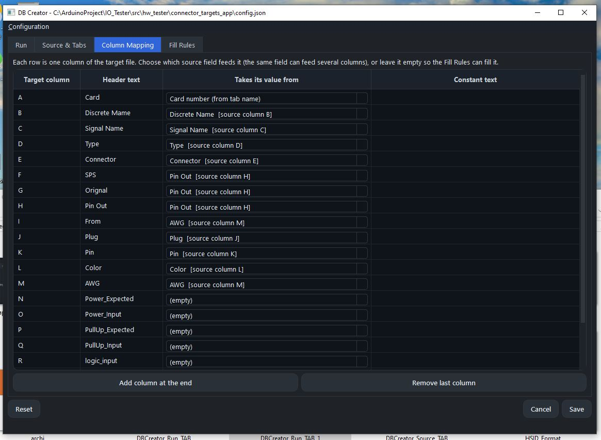
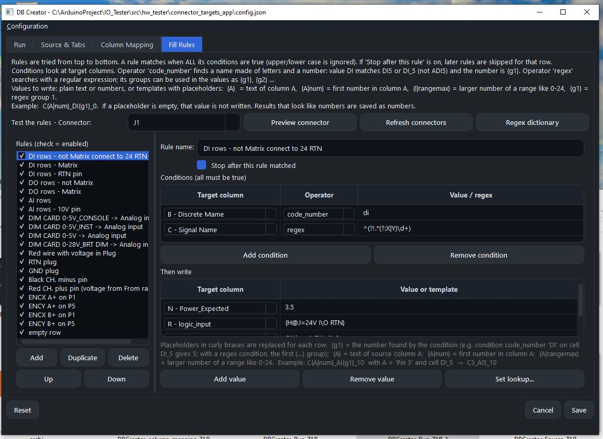

# DB Creator - User Manual

## 1. Purpose

DB Creator is part of the IO Tester application. It creates the test database Excel files that the IO Tester loads. From one source workbook, it creates:

- One `Target_J#.xlsx` file per connector (for example `Target_J1.xlsx`).
- One `Open_Issues.xlsx` file listing the rows that need manual review.

The source workbook is never modified.
The source workbook format is the multiTab excel workbook, each tab stand for spider card 
the idea of the DB building is first gather thes data from the source fiule than maipulate it on the traget files 

## 2. Starting the app

- **From the IO Tester:** switch to the **Engineering** layout and press **Generate DB** in the *Test/Debug* group. The app opens in its own window and the IO Tester stays usable.

## 3. Quick start

1. Open the **Run** page.
2. Press **Browse...** next to *Source workbook* and choose the source Excel file.
3. (Optional) Choose an *Output folder*. If empty, the files are written next to the source file.
4. Set *Target file name* to the desired template; `{conn}` is replaced by the connector.
5. Press **Load tabs from source** to read the tab names into the *Source & Tabs* page.
6. Pick a connector in the list and press **Preview connector** to check the result without writing anything.
7. Press **Generate files**.
8. Press **Open output folder** to see the results.

## 4. Pages

### 4.1 Run

| Control | Description |
|---|---|
| Source workbook | The Excel file to read - HSID . |
| Output folder | Where files are written. Empty = same folder as the source. |
| Target file name | Template where `{conn}` is replaced by the connector, for example `Target_{conn}.xlsx`. |
| Load tabs from source | Reads the tab names of the source file into the *Source & Tabs* page. |
| Connector / Preview connector | Shows the rows of one target file without writing anything. |
| Generate files | Writes the target files for all connectors and the issues file. |
| Open output folder | Opens the output folder. |

After browsing to the source (HSID) file and/or pressing **Load tabs from source**, the log displays the loaded tabs and detected connectors, including the connector dropdown menu.

The log shows the number of rows per connector, the issues file, and how many rows each rule matched.

If an output file is open in another program (for example Excel), the run is stopped. Close the file and run again.

### 4.1.1 Generate files
After generating files, the log displays:

- A list of created connector files and the number of entries per card for each file. For example: `J5: MTC_AFT_J5.xlsx card1=3, card2=13, card3=3, card4=6, card5=6, total=31`.
- A list of open issues: data excluded from the generated connector files. For example: `CARD 3: 6 x Duplicate Pin Out in connector file`.
- A list of `TBD` entries that the user needs to fill in before using the database. For example: `MTC_AFT_J19.xlsx: row 12, column T (Logic_Expected) = C4_DI_TBD_0 (source CARD 4, row 113)`.
- A list of duplicate pin outputs that the user needs to fix before using the database. For example: `MTC_AFT_J41.xlsx: Pin Out 20, duplicate target rows 4, 6 (source CARD 3, row 126)`.
- A list of missing logic-input details that the user needs to fill in before using the database. For example: `MTC_AFT_J9.xlsx: row 19, column T = C2_DI18_0, column R is empty (source CARD 2, row 31)`.
- A list of rules that were used.

All data is saved in `Open_Issues.xlsx` and `run_report.txt` in the same folder.

### 4.2 Source & Tabs

This section describes the layout of the source workbook.

- **Configuration file** - The `.json` file that stores the app's configuration and rules. Use **Load config file...** to select a different file.
- **Layout of the source tabs**
    - **First data row** - The first row containing data in the source (HSID) workbook. All source tabs must use the same structure.
    - **Connector prefix** - The letter or letters that each connector name starts with. Matching is not case-sensitive.
    - **Card number pattern** - A regex applied to the tab name. Capture group 1 is used as the card number. For example, use `(\d+)` for a tab named `Card 1`, or `#(\d+)` for `Spider Card #1`. If the pattern does not match, card 100 is used and listed in the issues report. **Regex dictionary** lists common regex symbols.
    - **Open issues file name** - The name of the file that lists issues found during generation.
    - **Sheet name inside target files** - The worksheet name used in the generated files.

#### 4.2.1 Tabs to search
- **Tabs to search** - Checked tabs are used, and their order determines row order in the target files. Use **Up**, **Down**, and **Add tab name...** to manage the list.

#### 4.2.2 Source columns

- **Source columns** - This table defines where DB Creator reads fields from the source workbook. Use **Add field** and **Remove selected** to manage the fields.
- **Key** - A stable identifier used by the configuration and mappings.
- **Label** - The human-readable name shown in the dropdown and issue reports.
- **Column letter** - The column in the source workbook's tabs where DB Creator reads the field.

### 4.3 Column Mapping

**The target file structure should not be changed.**
Each row is one column of the target file (A, B, C, ...).

| Column | Description |
|---|---|
| Target column | Letter of the column in the target file. |
| Header text | Header written in the first row. |
| Takes its value from | A source field, the card number, a constant text, or nothing. |
| Constant text | Used when the value comes from a constant. |

Use **Add column at the end** and **Remove last column** to change the number of columns.

### 4.4 Fill Rules

Rules fill the test columns (N to U) after the file is built. Rules run from top to bottom, and each rule has **conditions** and **values to write**.
after changes the resualt can be checked  useing 
- Preview connector shows the generated rows for the selected connector, including the current mappings and fill rules. It uses unsaved edits and does not write a file. Use it to check the output before clicking Generate files.
- Refresh connectors rereads the connector list from the selected source workbook using the current settings. Use it if you change the workbook or connector-detection settings and the dropdown list is stale. Loading tabs from the source already refreshes the list automaticall

- The Regex dictionary is a quick reference for patterns used to match text. In DB Creator, regexes are used for the card number pattern and for regex conditions in Fill Rules.

**Conditions** look at target columns. All conditions of a rule must be true.

| Operator | Meaning |
|---|---|
| contains / not_contains | Text is / is not inside the cell. |
| equals / not_equals | Cell is / is not exactly the text. |
| starts_with | Cell starts with the text. |
| regex | Cell matches the regular expression. |
| is_empty / not_empty | Cell is empty / not empty. |
| code_number | A name made of letters and a number. |

Case is ignored.

**Values** are text, a number, or a template:

| Template | Result |
|---|---|
| `{A}` | Text of column A. |
| `{A\|num}` | First number in column A. |
| `{I\|rangemax}` | Larger number of a range such as `0-24`. |
| `{g1}` | Group 1 of the regex condition. |
| `{H@J=text}` | Value of column H in the first row of the connector whose column J contains `text`. |
| `{H@N==10}` | Same, but column N must equal the text exactly. |

If a placeholder is empty, the value is not written. Number-like results are stored as numbers.

To look up a value from another row, select a row under **Then write** and press **Set lookup...**.
Choose the column to return, the column to search, the match type, and the value to find.
For example, return **H - Pin Out**, look in **J - Plug**, and find `24V I\O RTN`.
The first matching row in the same connector supplies the value; matching ignores case.
If there is no match or its returned cell is empty, the assignment is not written.

**Stop after this rule matched** skips the remaining rules for that row.

To test rules, choose a connector on this page and press **Preview connector**. The preview includes unsaved edits. **Refresh connectors** reads the connector list from the source again.

## 5. Saving the configuration

- **Save** - validates the settings and writes your changes to the active configuration file. If the file already exists, the app asks you to confirm before replacing it. The saved settings become the new baseline.
- **Cancel** - discards unsaved edits and restores the last saved settings. It does not close the configuration window.
- **Reset** - discards unsaved edits and reloads the active configuration file from disk. If no configuration file is loaded, it offers to restore the built-in defaults. Reset does not save; press **Save** afterward to keep the restored settings.

The **Configuration** menu offers: *Load config file...*, *Save*, *Save as...*, *Reset (reload file)* and *Built-in defaults*.

`config.json` next to `app.py` is loaded at start-up if it exists. When closing with unsaved changes, the app asks whether to save.

## 6. Output files

- **`Target_J#.xlsx`** - one per connector, ready to load in the IO Tester.
- **`Open_Issues.xlsx`** - rows that need manual review:
    - A tab whose name does not match the card number pattern is listed with card 100.
    - Every row whose non-empty **Pin Out** also appears in the same connector file is listed, with the target file and matching row numbers in **Notes**. Values are compared without regard to case or surrounding spaces. The run report also lists the duplicates.
    - Rows with a value in target column **T** and an empty or whitespace-only column **R** are listed with their source and target locations. The run report also lists these rows.
    - Rows with an empty connector cell are skipped and omitted here.
    - Rows that matched no enabled fill rule and whose rule target columns stayed empty are listed as *"No fill rule matched; rule target columns stayed empty"*.
    - Every cell in a target file that still contains `TBD` is listed as *"TBD value in target file; needs manual fix"*. The **Notes** column and text run report show the target file, row, column and value (for example `V1_J5.xlsx: row 3, column R (logic_input) = TBD_DI`). The source tab, card and source row are in the other columns.

If any output files already exist, **Generate files** asks before replacing them.

## 7. Troubleshooting

| Problem | Solution |
|---|---|
| "Output file is open" error | Close the file in Excel and generate again. |
| No connectors in the list | Check the source file, the connector prefix and the tab list, then press **Load tabs from source**. |
| Wrong values in test columns | Use **Preview connector** on the Fill Rules page and check rule order and conditions. |
| Many rows in `Open_Issues.xlsx` | Add or adjust fill rules for those rows. |
| Button in the IO Tester does nothing | The log shows the path that was not found. In a packaged build, check that `ConnectorTargets.exe` is next to `IOTester.exe`. When running from source, check that the `connector_targets_app` folder exists. |
