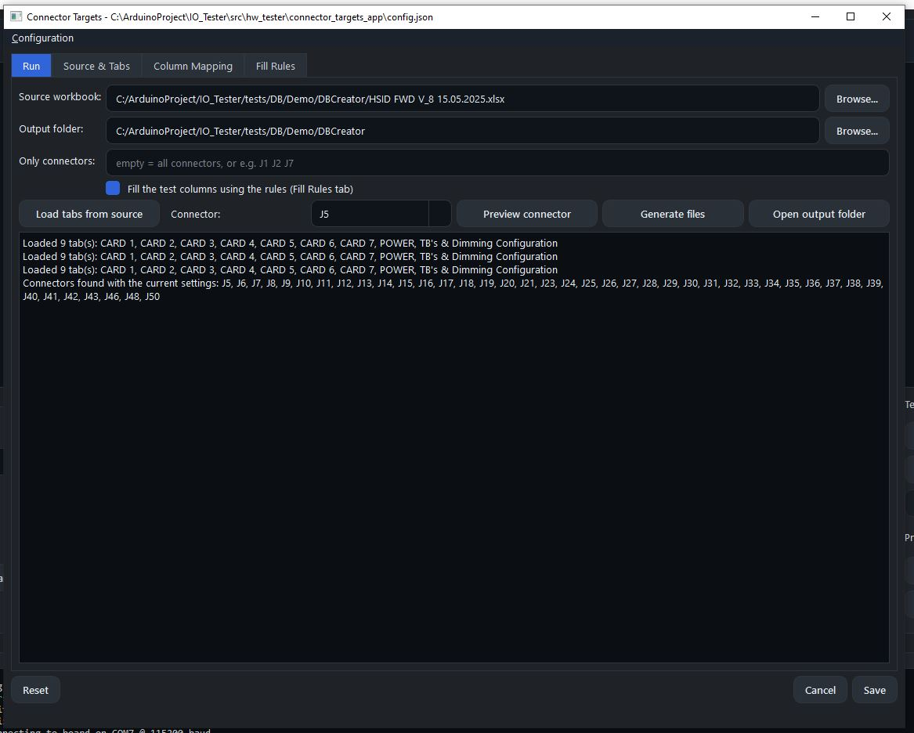

# Connector Targets - User Manual

## 1. Purpose

Connector Targets is a part of the IO Tester APP. it help to create the Tester DB "excel file" the IO Tester loads. From one source workbook it creates:

- One `Target_J#.xlsx` file per connector (for example `Target_J1.xlsx`), built from the Spider Card tabs.
- One `Open_Issues.xlsx` file listing the rows that need manual review.

The source workbook is never modified.

## 2. Starting the app

- **From the IO Tester:** switch to the **Engineering** layout and press **Connector Targets** in the *Test/Debug* group. The app opens in its own window and the IO Tester stays usable.
- **From the command line:**

## 3. Quick start

1. Open the **Run** page.
2. Press **Browse...** next to *Source workbook* and choose the source Excel file.
3. (Optional) Choose an *Output folder*. If empty, the files are written next to the source file.
4. Press **Load tabs from source** to read the tab names into the *Source & Tabs* page.
5. Pick a connector in the list and press **Preview connector** to check the result without writing anything.
6. Press **Generate files**.
7. Press **Open output folder** to see the results.

## 4. Pages

### 4.1 Run

| Control | Description |
|---|---|
| Source workbook | The Excel file to read - HSID . |
| Output folder | Where files are written. Empty = same folder as the source. |
| Load tabs from source | Reads the tab names of the source file into the *Source & Tabs* page. |
| Connector / Preview connector | Shows the rows of one target file without writing anything. |
| Generate files | Writes the target files for all connectors and the issues file. |
| Open output folder | Opens the output folder. |

The log shows the number of rows per connector, the issues file, and how many rows each rule matched.

If an output file is open in another program (for example Excel), the run is stopped. Close the file and run again.

### 4.2 Source & Tabs

Describes the layout of the source workbook.

- **Configuration file** - the `.json` file used by the app. **Load config file...** selects another one.
- **Layout of the source tabs**
    - Connector prefix - the letter(s) every connector name starts with (not case sensitive).
    - First data row.
    - Card number pattern - a regex applied to the tab name; group 1 is the card number. **Regex dictionary** lists the common regex symbols.
    - Target file name - template where `{conn}` is replaced by the connector, for example `Target_{conn}.xlsx`.
    - Sheet name inside the target files.
- **Tabs to search** - checked tabs are used, and their order is the row order in the target files. Use **Up**, **Down** and **Add tab name...**.
- **Source columns** - which Excel column holds which field. Use **Add field** and **Remove selected**.

### 4.3 Column Mapping

Each row is one column of the target file (A, B, C, ...).

| Column | Description |
|---|---|
| Target column | Letter of the column in the target file. |
| Header text | Header written in the first row. |
| Takes its value from | A source field, the card number, a constant text, or nothing. |
| Constant text | Used when the value comes from a constant. |

Use **Add column at the end** and **Remove last column** to change the number of columns.

### 4.4 Fill Rules

Rules fill the test columns (N to U) after the file is built. Rules run from top to bottom, and each rule has **conditions** and **values to write**.

**Conditions** look at target columns. All conditions of a rule must be true.

| Operator | Meaning |
|---|---|
| contains / not_contains | Text is / is not inside the cell. |
| equals / not_equals | Cell is / is not exactly the text. |
| starts_with | Cell starts with the text. |
| regex | Cell matches the regular expression. |
| is_empty / not_empty | Cell is empty / not empty. |
| code_number | A name made of letters and a number. |

Case is ignored.

**Values** are text, a number, or a template:

| Template | Result |
|---|---|
| `{A}` | Text of column A. |
| `{A\|num}` | First number in column A. |
| `{I\|rangemax}` | Larger number of a range such as `0-24`. |
| `{g1}` | Group 1 of the regex condition. |
| `{H@J=text}` | Value of column H in the first row of the connector whose column J contains `text`. |
| `{H@N==10}` | Same, but column N must equal the text exactly. |

If a placeholder is empty, the value is not written. Number-like results are stored as numbers.

**Stop after this rule matched** skips the remaining rules for that row.

To test rules, choose a connector on this page and press **Preview connector**. The preview includes unsaved edits. **Refresh connectors** reads the connector list from the source again.

## 5. Saving the configuration

- **Save** - saves Source & Tabs, Column Mapping and Fill Rules to the configuration file.
- **Cancel** - discards the edits made since the last save.
- **Reset** - re-reads the loaded configuration file (built-in defaults if none is loaded).

The **Configuration** menu offers: *Load config file...*, *Save*, *Save as...*, *Reset (reload file)* and *Built-in defaults*.

`config.json` next to `app.py` is loaded at start-up if it exists. When closing with unsaved changes, the app asks whether to save.

## 6. Output files

- **`Target_J#.xlsx`** - one per connector, ready to load in the IO Tester.
- **`Open_Issues.xlsx`** - rows that need manual review:
    - Rows with an empty connector cell are kept in a connector file only when the rows directly above and below belong to the same connector, and all of them are listed here.
    - Rows that matched no enabled fill rule and whose rule target columns stayed empty are listed as *"No fill rule matched; rule target columns stayed empty"*.
    - Every cell in a target file that still contains `TBD` is listed as *"TBD value in target file; needs manual fix"*. The **Notes** column tells you where to fix it: the target file, the row, the column letter and header, and the current value (for example `V1_J5.xlsx: row 3, column R (logic_input) = TBD_DI`). The source tab, card and source row are in the other columns.

## 7. Troubleshooting

| Problem | Solution |
|---|---|
| "Output file is open" error | Close the file in Excel and generate again. |
| No connectors in the list | Check the source file, the connector prefix and the tab list, then press **Load tabs from source**. |
| Wrong values in test columns | Use **Preview connector** on the Fill Rules page and check rule order and conditions. |
| Many rows in `Open_Issues.xlsx` | Add or adjust fill rules for those rows. |
| Button in the IO Tester does nothing | The log shows the path that was not found; check that the `connector_targets_app` folder exists. |
