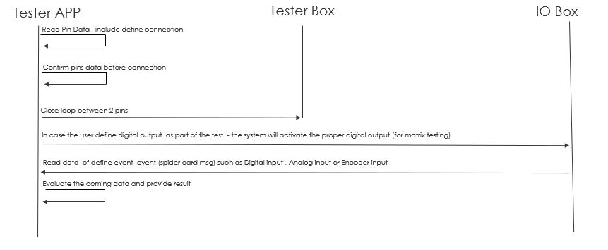

# Logic Test

The Logic test validates a card input by connecting a primary pin to a related pin and checking the expected DI, AI, or IE value. It is selected when the row contains a `Logic_Expected` value that is not empty and is not `-`.

## DOS
- The "logic expected" value is not empty
- Powerup test result pin A and pin B = True and 
- for DI and EI connection the valid configuraion is :
  - both Pin A and Pin B power measured value need to be below 4V (configuration) and 
  - pin A power measured value = 0 and pin A power measured value > 0 or 
  - pin B power measured value = 0 and pin B power measured value > 0
- for AI connection the valid configuraion is :
  - both Pin A and Pin B power measured value need to be below 13V (configuration) and 
  - pin A power measured value > 0 and pin A power measured value < 13V or 
  - pin B power measured value > 0 and pin B power measured value < 13V
 


## Procedure

`logic_test()` performs these steps:



1. Resolve and route the primary pin on system A.
2. Read the related pin number from `Logic_Pin_Input`.
3. Find the related pin in the loaded pin table.
4. Verify that the related pin has a passing Power result.
5. Validate the measured power combination for the requested logic type.
6. Resolve and route the related pin on system B.
7. Activate and verify any card output specified by `Logic_Command`.
8. Parse `Logic_Expected` for a DI, AI, or IE input.
9. Read the card input and compare it with the expected value.
10. Deactivate configured outputs and clear the mux matrix.

## Configuration

Typical row fields are:

| Field | Purpose |
| --- | --- |
| `Logic_Pin_Input` | Related connector pin number, or comma-separated pin numbers |
| `Logic_Command` | Optional card output command used during the test |
| `Logic_Expected` | Expected card input value |

The related pin must already have a passing Power result in the pin table. The expected value identifies the card and input type, such as DI, AI, or IE, using the project's event-string format.

## Input Types

- **DI**: Reads a digital input and compares HIGH/LOW state.
- **AI**: Reads an analog input and compares the measured value within tolerance.
- **IE**: Reads an encoder value and compares it with the expected value.

In simulation mode, the input value is set to the expected value so the logic flow can be exercised without connected cards.

## Results

The function returns:

```text
(measured_voltage, success, message)
```

- `measured_voltage`: Currently `0.0`; the result is based on the card input state.
- `success`: `True` when the card input matches `Logic_Expected`.
- `message`: Result or diagnostic description.

The pin table receives the Pass/Fail status and result reason after the test finishes.

## Failure Conditions

The test fails when:

- The primary mux route cannot be configured.
- `Logic_Pin_Input` is missing or contains an invalid pin number.
- The related pin cannot be found in the pin table.
- The related pin does not have a passing Power result.
- The measured power combination is invalid for the requested logic type.
- A card command cannot be activated, verified, or deactivated.
- `Logic_Expected` cannot be parsed.
- The measured DI, AI, or IE value does not match the expected value.

## Source

- `src/hw_tester/core/test_logic.py`
  - `logic_test(test_handle, pin, pin_table_rows)`
- `src/hw_tester/core/test_handle.py`
  - Selects the test and updates the pin table.

## Logic Test Flow Viewer

The static Logic test flow is available in
[`logic-test-flow.html`](../interactive/logic-test-flow.html).

This documentation copy contains the embedded flow diagram without live trace
updates or application-server dependencies.

