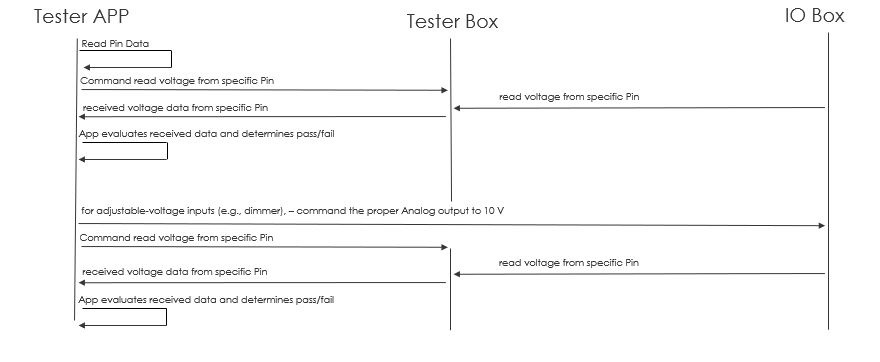

# Power Test

The Power test validates the voltage supplied to one connector pin. It is selected when the row contains a `Power_Expected` value that is not empty and is not `-`.

## DOS
- The "Power expected" value is not empty 

## Procedure

`power_test()` performs these steps:



1. Resolve the connector pin pair and analog measurement pin.
2. Convert the pin number to mux bits and route the pin to the measurement path.
3. Measure the initial voltage.
4. If `Power_Input` is empty or "P\Power", compare the measurement directly with `Power_Expected`.
5. If `Power_Input` is configured, verify the initial voltage is approximately `0 V`.
6. Parse the configured card command.
7. Activate and verify the card AO or DO output.
8. Wait for stabilization and measure the voltage again.
9. Deactivate and verify the card output.
10. Compare the final measurement with `Power_Expected`.

## Configuration

Typical row fields are:

| Field | Purpose |
| --- | --- |
| `Power_Expected` | Expected final voltage in volts |
| `Power_Input` | Optional card command, such as an AO or DO event |

Voltage comparisons use the active settings tolerance. In simulation mode, the measured value is generated from the expected voltage with a small variation.

## Results

The function returns:

```text
(measured_voltage, success, message)
```

- `measured_voltage`: Final voltage measurement in volts.
- `success`: `True` when the voltage is within tolerance and configured outputs operated correctly.
- `message`: Result or diagnostic description.

The pin table receives the measured value, Pass/Fail status, and result reason after the test finishes.

## Failure Conditions

The test fails when:

- The mux matrix cannot be configured.
- The analog pin is missing from the pin map.
- The initial voltage is not near zero when an external input is used.
- A card output cannot be activated, verified, or deactivated.
- The final voltage is outside the configured tolerance.

## Source

- `src/hw_tester/core/test_power.py`
  - `power_test(test_handle, pin)`
- `src/hw_tester/core/test_handle.py`
  - Selects the test and updates the pin table.

## Power Test Flow Viewer

The static Power test flow is available in
[`power-test-flow.html`](../interactive/power-test-flow.html).

This documentation copy contains the embedded flow diagram without live trace
updates or application-server dependencies.
