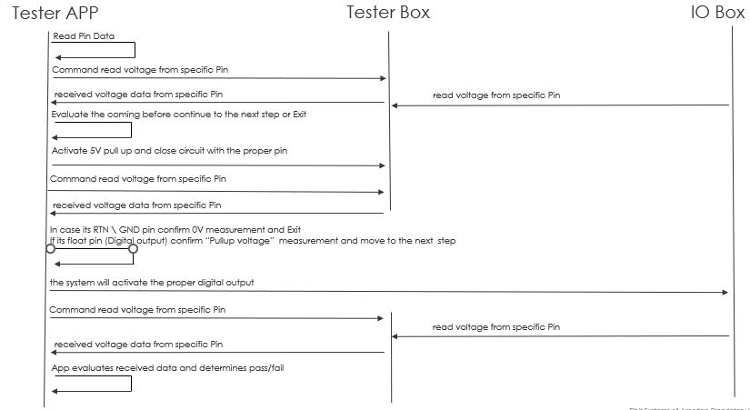

# PullUp Test

The PullUp test validates the pull-up path and its related card output for one connector pin. It is selected when the row contains a `PullUp_Input` value that is not empty and is not `-`.

## DOS
- Powerup test result = True and 
- Powerup expected value = 0 and 
- The "Pullup expected" value is not empty 

## Procedure

`pullup_test()` performs these steps:



1. Resolve the connector pin pair, analog measurement pin, and pull-up pin.
2. Convert the pin number to mux bits and route the pin to the measurement path.
3. Activate the configured pull-up behavior.
4. Wait for signal stabilization.
5. Measure the initial voltage and verify that it is approximately `0 V`.
6. Close the general relay.
7. Measure the voltage after pull-up activation.
8. Compare it with `PullUp_Expected`.
9. If `PullUp_Input` is `G` verify the initial voltage is near 0V, deactivate the pull-up and complete the ground test.
10. Otherwise, activate and verify the configured card DO output.
11. Measure the voltage after the card output changes and verify the expected state.
12. Deactivate the pull-up, relay, and card output, then verify cleanup.

## Configuration

Typical row fields are:

| Field | Purpose |
| --- | --- |
| `PullUp_Expected` | Expected pull-up voltage in volts |
| `PullUp_Input` | `G` for a ground test, or a card DO command |

The pull-up pin and relay mapping come from the active board configuration. Voltage comparisons use the active settings tolerance.

## Results

The function returns:

```text
(measured_voltage, success, message)
```

- `measured_voltage`: Final voltage measurement in volts.
- `success`: `True` when the pull-up and any configured card output pass validation.
- `message`: Result or diagnostic description.

The pin table receives the measured value, Pass/Fail status, and result reason after the test finishes.

## Failure Conditions

The test fails when:

- A required pull-up or analog pin is missing.
- The mux matrix cannot be configured.
- The initial voltage is not near zero.
- The pull-up voltage is outside the `PullUp_Expected` tolerance.
- A configured card DO output cannot be activated, verified, or deactivated.
- The voltage after the card output changes is not the expected value.

## Source

- `src/hw_tester/core/test_pullUp.py`
  - `pullup_test(test_handle, pin)`
- `src/hw_tester/core/test_handle.py`
  - Selects the test and updates the pin table.

## PullUp Test Flow Viewer

The static PullUp test flow is available in
[`pullup-test-flow.html`](../interactive/pullup-test-flow.html).

This documentation copy contains the embedded flow diagram without live trace
updates or application-server dependencies.
