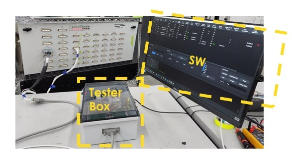
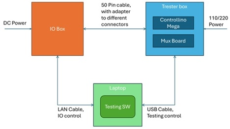

# IO Tester | Board Presentation

  <a href="#overview">1. Overview</a>
  <a href="#challenge">2. Challenge</a>
  <a href="#solution">3. Solution</a>
  <a href="#workflow">4. Workflow</a>
  <a href="#capabilities">5. Capabilities</a>
  <a href="#benefits">6. Benefits</a>

<section class="presentation-slide presentation-slide--title" id="overview">
  
Hardware integration and verification

  <h2>IO Tester</h2>
  
A dedicated system for verifying IO Box wiring against the HSID \ net list.

  
Automated electrical checks, real-time results, and report generation in one integrated setup.

  
  <nav class="presentation-nav" aria-label="Slide navigation">
    Slide 1 of 6
    <a href="#challenge">Next: The challenge →</a>
  </nav>
</section>

<section class="presentation-slide" id="challenge">
  
The challenge

  <h2>Manual verification takes time and integration resources</h2>
  <ul>
    <li>A full IO Box test currently can takes about one day.</li>
    <li>Wiring testing is sisyphian work that is sensitve to human errors.</li>
    <li>Finding issues early is important during hardware development and integration.</li>
    <li>Traditional full IO test setups may depend on cockpit panels and a SimEngine machine.</li>
  </ul>
  <nav class="presentation-nav" aria-label="Slide navigation">
    <a href="#overview">← Previous</a>
    Slide 2 of 6
    <a href="#solution">Next: The solution →</a>
  </nav>
</section>

<section class="presentation-slide" id="solution">
  
The solution

  <h2>A dedicated, isolated test environment</h2>
  
The Tester Box, IO Box with Spider cards, and a standard PC running the Tester application work together to test connector wiring.

  <ul>
    <li>The single D-sub logic interface simulates cockpit panel operation.</li>
    <li>Load Excel test data based on the relevant subset of the HSID net list.</li>
    <li>Test without a voltmeter, cockpit, or SimEngine machine.</li>
  </ul>
  
  <nav class="presentation-nav" aria-label="Slide navigation">
    <a href="#challenge">← Previous</a>
    Slide 3 of 6
    <a href="#workflow">Next: Workflow →</a>
  </nav>
</section>

<section class="presentation-slide" id="workflow">
  
How it works

  <h2>From setup to documented results</h2>
  <ol>
    <li>Launch the application and run I-BIT to check system readiness.</li>
    <li>Power up the IO Box and connect the test components.</li>
    <li>Start the test. The application commands the Tester Box and, where needed, the IO Box.</li>
    <li>The Tester Box measures voltage or closes a circuit between connector pins.</li>
    <li>View test results in real time.</li>
    <li>Generate a test report and bug list.</li>
  </ol>
  <nav class="presentation-nav" aria-label="Slide navigation">
    <a href="#solution">← Previous</a>
    Slide 4 of 6
    <a href="#capabilities">Next: Capabilities →</a>
  </nav>
</section>

<section class="presentation-slide" id="capabilities">
  
What it tests

  <h2>Four connector test types, plus system checks</h2>
  <ul>
    <li><strong>Power:</strong> Measures pin voltage, optionally using an AO command.</li>
    <li><strong>Pull-Up:</strong> Checks the pull-up voltage, optionally using a DO command.</li>
    <li><strong>Logic:</strong> Checks DI, AI, or incremental encoder results between pins.</li>
    <li><strong>Cable:</strong> Verifies expected continuity and detects unexpected connections.</li>
  </ul>
  
<strong>Comm Test</strong> checks hardware communications. <strong>I-BIT</strong> scans connector pins for circuit faults and can optionally check fuse paths.

  <nav class="presentation-nav" aria-label="Slide navigation">
    <a href="#workflow">← Previous</a>
    Slide 5 of 6
    <a href="#benefits">Next: Benefits →</a>
  </nav>
</section>

<section class="presentation-slide" id="benefits">
  
Expected benefits

  <h2>Faster feedback, earlier fault detection</h2>
  <ul>
    <li><strong>Target test duration:</strong> Reduce a full IO Box test from one day to approximately 1.5 hours.</li>
    <li><strong>Earlier issue discovery:</strong> Find IO Box wiring problems during hardware development and integration.</li>
    <li><strong>Clear evidence:</strong> Provide live pass/fail results, official reports, and bug summaries.</li>
    <li><strong>Built-in protection:</strong> Help prevent unintended circuit closures, such as connecting 24 V directly to GND.</li>
  </ul>
  <nav class="presentation-nav" aria-label="Slide navigation">
    <a href="#capabilities">← Previous</a>
    Slide 6 of 6
    <a href="#overview">Back to the beginning ↑</a>
  </nav>
</section>

